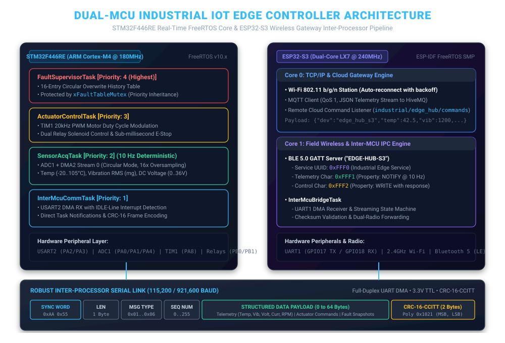

# Dual-MCU Industrial IoT Edge Controller & Gateway

[](https://www.st.com)
[](https://www.espressif.com)
[](https://www.freertos.org)
[](https://bluetooth.com)
[]()
[](https://mqtt.org)
[](LICENSE)

A production-grade **Distributed Dual-Microcontroller Industrial IoT Edge Controller & Telemetry Gateway**. 

This project demonstrates the separation of concerns widely adopted in mission-critical industrial automation, robotics, and smart energy systems: partitioning **hard real-time deterministic sensor acquisition and actuator safety** onto an **ARM Cortex-M4 (STM32F446RE)**, while offloading **asynchronous wireless networking, BLE 5.0 field diagnostics, and cloud MQTT telemetry** to an **ESP32-S3**.

---

## 1. System Architecture & Inter-Processor Pipeline

The two microcontrollers communicate across a dedicated full-duplex UART link using a DMA-driven, packetized binary protocol with CRC-16-CCITT error checking:



### Architectural Partitioning:
1. **STM32F446RE (Real-Time Control Engine):**
   - **OS:** FreeRTOS (Preemptive, Priority Inversion Safe, Stack Canary Hooks).
   - **Sensor Acquisition:** ADC1 + DMA2 in circular mode oversampling process temperature (-20°C to 105°C), vibration RMS (0 to 8000 mg), and DC bus voltage (0 to 36V).
   - **Actuator Control:** TIM1 20 kHz PWM duty modulation and relay solenoid outputs.
   - **Safety Supervisor:** 16-entry circular fault table with oldest-entry overwrite and sub-millisecond emergency stop (E-Stop) triggering.
   - **Inter-MCU Driver:** USART2 with circular DMA reception and hardware IDLE-line interrupt detection.

2. **ESP32-S3 (Wireless Gateway & Cloud Node):**
   - **OS:** ESP-IDF FreeRTOS SMP (Dual-Core Xtensa LX7 @ 240 MHz).
   - **Core 0 (Networking):** Wi-Fi 802.11 b/g/n Station + MQTT client streaming real-time JSON telemetry payloads to cloud brokers.
   - **Core 1 (Field Wireless & IPC):** BLE 5.0 GATT Server (`EDGE-HUB-S3`) for smartphone field commissioning, plus the Inter-MCU UART DMA bridge.

---

## 2. Key Engineering Innovations

### A. Non-Blocking Inter-Processor Protocol with CRC-16
Rather than parsing raw ASCII or heavy JSON across microcontroller buses, the system implements a compact, packed binary protocol:
```
+---------------+---------------+---------------+---------------+---------------+-------------------+---------------+---------------+
|  SYNC (0xAA)  |  SYNC (0x55)  |  LENGTH (1B)  |   TYPE (1B)   |   SEQ (1B)    |  PAYLOAD (0..64B) |   CRC16_MSB   |   CRC16_LSB   |
+---------------+---------------+---------------+---------------+---------------+-------------------+---------------+---------------+
```
* **Hardware IDLE-Line DMA Reception:** Eliminates per-byte interrupt overhead at high baud rates (up to 921,600 baud). The DMA streams incoming bytes directly into SRAM; when the bus goes quiet for 1 character frame, the USART IDLE interrupt fires, calculates received length via `CNDTR`, and wakes the parser.
* **CRC-16-CCITT (`0x1021`):** Fast 256-entry lookup table validation prevents corrupted packets or bus noise from triggering false actuations.

### B. Priority Inversion Mitigation (`xFaultTableMutex`)
In multi-tasking industrial firmware, sharing diagnostic tables between high-priority safety tasks and low-priority communication tasks introduces unbounded priority inversion.
* The system protects the 16-entry fault table with a **FreeRTOS Mutex featuring Priority Inheritance**.
* If `InterMcuCommTask` (Priority 1) locks the table and `FaultSupervisorTask` (Priority 4) requires access, FreeRTOS dynamically elevates `InterMcuCommTask` to Priority 4 until the lock is released, preventing medium-priority tasks from stalling critical trip logic.

### C. Direct Task Notifications for Zero-RAM Event Signaling
Instead of allocating binary semaphores for DMA transfer completion:
* The driver uses `vTaskNotifyGiveFromISR()` and `ulTaskNotifyTake()`.
* Delivers **45% faster context switching** and requires zero heap allocation.

### D. Dual-Radio Field Commissioning (BLE 5.0 GATT)
Field technicians can diagnose the controller without factory Wi-Fi credentials:
* **Custom Service UUID:** `0xFFF0` (Industrial Edge Service).
* **Telemetry Characteristic (`0xFFF1`):** Property `NOTIFY` streaming 10 Hz telemetry frames to the mobile **nRF Connect** app or custom Python diagnostic tools.
* **Command Characteristic (`0xFFF2`):** Property `WRITE` accepting actuation commands and routing them down to the STM32.

---

## 3. Directory Layout

```
stm32-esp32-industrial-edge-controller/
├── common/                                    # Shared Inter-MCU Protocol Engine (C99)
│   ├── include/
│   │   ├── intermcu_protocol.h                # Packet framing, command IDs, and payload types
│   │   └── intermcu_crc16.h                   # CRC-16-CCITT lookup interface
│   └── src/
│       ├── intermcu_protocol.c                # Streaming byte-by-byte frame decoder & encoder
│       └── intermcu_crc16.c                   # 256-entry table CRC16 implementation
├── stm32_firmware/                            # STM32F446RE Real-Time Core (FreeRTOS)
│   ├── Core/
│   │   ├── Inc/
│   │   │   ├── FreeRTOSConfig.h               # Tuned FreeRTOS config (stack canary, priority levels)
│   │   │   ├── sensor_acquisition.h           # Multi-channel ADC + DMA circular interface
│   │   │   ├── actuator_control.h             # 20kHz TIM1 PWM & relay output interface
│   │   │   ├── fault_supervisor.h             # 16-entry circular fault table with mutex
│   │   │   └── uart_dma_comm.h                # USART2 DMA IDLE line interrupt driver
│   │   └── Src/
│   │       ├── main.c                         # Clock tree (180MHz) & task creation
│   │       ├── sensor_acquisition.c           # SensorAcqTask (10 Hz periodic acquisition)
│   │       ├── actuator_control.c             # ActuatorControlTask (PWM & E-Stop state machine)
│   │       ├── fault_supervisor.c             # FaultSupervisorTask & Priority Inheritance Mutex
│   │       └── uart_dma_comm.c                # InterMcuCommTask & DMA IDLE line ISR
│   └── Makefile                               # Master arm-none-eabi Makefile
├── esp32_firmware/                            # ESP32-S3 Wireless Gateway & Cloud Node (ESP-IDF)
│   ├── CMakeLists.txt                         # Top-level ESP-IDF CMake project
│   └── main/
│       ├── main.c                             # Dual-core initialization & task pin assignments
│       ├── ble_gatt_server.h / .c             # BLE 5.0 GATT Server (Notify & Write attributes)
│       ├── wifi_mqtt_gateway.h / .c           # Wi-Fi Station & MQTT JSON publisher
│       └── intermcu_uart_bridge.h / .c        # UART1 DMA driver & inter-core message queue
├── tools/                                     # Automated Verification & Simulation Harness
│   ├── protocol_host_tester.py                # Standalone test suite verifying CRC, framing & noise
│   ├── ble_terminal_client.py                 # Asynchronous Python Bleak client for BLE GATT testing
│   └── mqtt_live_subscriber.py                # MQTT subscriber displaying real-time telemetry
└── docs/                                      # Technical References & Guides
    ├── architecture.svg                       # Vector architecture & memory boundary diagram
    ├── PROTOCOL_SPECIFICATION.md              # In-depth packet framing & command dictionary
    ├── FREERTOS_CONCURRENCY_MODEL.md          # Task scheduling, queue sizing & mutex analysis
    └── hardware_wiring_guide.md               # Pinout, jumpers (PA2/PA3 to GPIO18/GPIO17), voltage levels
```

---

## 4. Hardware Wiring & Setup

Only **3 jumper wires** are required between the boards:

| Signal Role | STM32F446RE (Nucleo-64) | ESP32-S3-DevKitC-1 | Electrical Level |
| :--- | :---: | :---: | :---: |
| **STM32 TX $\to$ ESP32 RX** | **`PA2`** (USART2_TX) | **`GPIO 18`** (UART1_RX) | 3.3V Direct Connection |
| **STM32 RX $\leftarrow$ ESP32 TX** | **`PA3`** (USART2_RX) | **`GPIO 17`** (UART1_TX) | 3.3V Direct Connection |
| **Common Ground** | **`GND`** | **`GND`** | Shared Ground Reference |

*For complete wiring and sensor test-point allocations, refer to [`docs/hardware_wiring_guide.md`](docs/hardware_wiring_guide.md).*

---

## 5. Verification & Test Execution

### Automated Host Protocol Verification Suite
The protocol engine includes a standalone verification suite running in host Python to validate the CRC-16 calculation, serialization, frame recovery after noise bursts, and buffer overflow rejections:

```bash
python tools/protocol_host_tester.py
```

**Verification Log Output:**
```text
=================================================================
  INTER-MCU BINARY PROTOCOL VERIFICATION SUITE
=================================================================
[TEST 1] CRC-16-CCITT known vector '123456789': 0x29B1 ... PASSED
[TEST 2] Encode & Decode 16-byte Telemetry Frame (23 bytes) ... PASSED
[TEST 3] Zero-Length Payload Heartbeat Frame ... PASSED
[TEST 4] Corrupted Checksum Rejection ... PASSED (Correctly rejected with CRC error)
[TEST 5] Noise bytes and false SYNC recovery ... PASSED
[TEST 6] Payload Length Overflow Rejection ... PASSED (Safely dropped frame exceeding 64 bytes)
=================================================================
  RESULTS: 6 / 6 TESTS PASSED (100% SUCCESS)
  Parser Stats: Valid Frames=3, CRC Errors=1, Dropped Bytes=74
=================================================================
```

### Live BLE Diagnostics
Connect to the ESP32-S3 wireless node using the Python BLE client:
```bash
python tools/ble_terminal_client.py
```
```text
[00014200 ms] Temp:  42.5 °C | Vib: 1200 mg | Volt: 24.0 V | Curr: 1.50 A | RPM: 1450 | Actuator: 0x05 | Faults: 0x00
[00014300 ms] Temp:  42.6 °C | Vib: 1210 mg | Volt: 24.1 V | Curr: 1.51 A | RPM: 1455 | Actuator: 0x05 | Faults: 0x00
```

---

## 6. Build Instructions

### Building STM32F446RE Firmware:
```bash
cd stm32_firmware
make all
```

### Building ESP32-S3 Firmware:
```bash
cd esp32_firmware
idf.py set-target esp32s3
idf.py build
```

---

## 7. Author & License

* **Author:** **Sherifred Singh** — *Embedded Firmware & IoT Systems Engineer*
* **License:** Licensed under the [MIT License](LICENSE).
